# protocol-droid — Architecture

A Rust Model Context Protocol toolkit that speaks every published spec revision at
once, through one canonical internal representation.

This document describes the architecture as it is in the code today. Where a
decision was contested or has a reason that is not visible from the signature, the
reason is written down too — those are the parts a reader is most likely to
"fix" by accident.

---

## Table of contents

- [The problem this shape solves](#the-problem-this-shape-solves)
- [Crates](#crates)
- [Layer model](#layer-model)
- [The canonical IR](#the-canonical-ir)
- [Negotiation and the FeatureProfile](#negotiation-and-the-featureprofile)
- [Request lifecycle](#request-lifecycle)
- [Serving](#serving)
- [The bridge](#the-bridge)
- [Transports](#transports)
- [Error handling](#error-handling)
- [Concurrency and determinism](#concurrency-and-determinism)
- [Safety and security](#safety-and-security)
- [Build, test and CI](#build-test-and-ci)
- [Known gaps](#known-gaps)

---

## The problem this shape solves

MCP publishes a new revision every few months, and revisions disagree. Not only
about which methods exist — about the _shape_ of shared ones.
`CallToolResult.content` is `Vec<CallToolResultContentChoice>` at `2024-11-05`
and `Vec<ContentBlock>` from `2025-06-18`. `structuredContent` exists only on
revisions new enough to have it. A client speaking one revision and a server
speaking another is the normal case, not an edge case.

The obvious fix — one set of wire types per revision, and pick with `cfg` — means
the choice happens at compile time. A binary that speaks one revision cannot
speak the other, so every consumer needs a fork, and a library consumer needs
either four copies of their server or a feature flag that removes half their
methods at a time.

protocol-droid makes the choice at **runtime**, once per session, from what the
peer actually negotiated. Three commitments follow from that, and the rest of the
codebase is mostly a consequence of them.

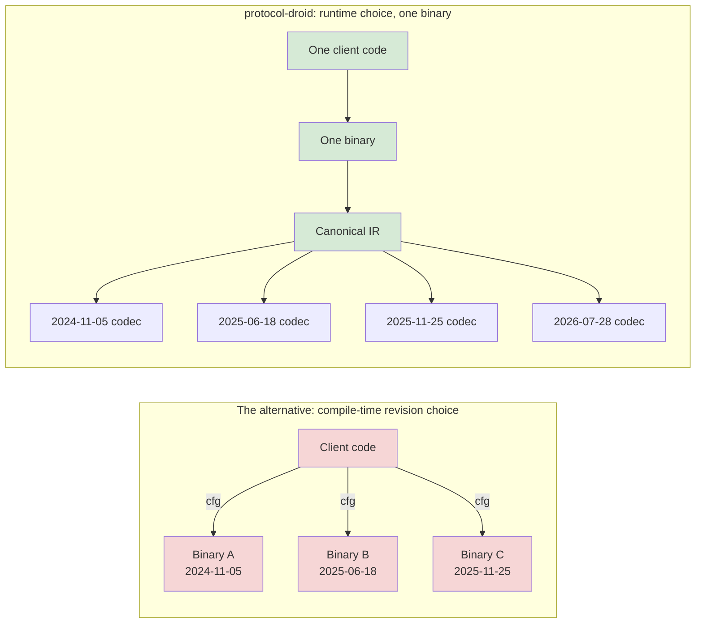

The three commitments:

1. **One canonical IR, many wire codecs.** Application code speaks a
   version-agnostic superset. Per-revision codecs lift wire into IR and lower IR
   back to the wire, for whatever was negotiated. All revisions compile
   simultaneously — they are data, not mutually exclusive features.
2. **Feature gating from the real negotiation.** A pure function turns
   (protocol version × client capabilities × server capabilities × transport)
   into a `FeatureProfile`. Every feature-specific path consults it. Nothing is
   silently dropped; unavailable features return a typed error or degrade under
   an explicit, opt-in `DegradePolicy`.
3. **Every transport the spec has ever defined**, all at once: stdio, legacy
   HTTP+SSE, Streamable HTTP (stateful), and the `2026-07-28` stateless
   lifecycle.

---

## Crates

Four crates, deliberately few. The schema types are generated data and must
coexist; the macro crate must be separate because proc macros cannot live in the
crate that uses them.

| Crate                   |  Lines | Role                                                        |
| ----------------------- | -----: | ----------------------------------------------------------- |
| `protocol-droid`        | 76,676 | The library. Everything below.                              |
| `protocol-droid-schema` |  3,352 | Vendored spec + codegen. Generates per-revision wire types. |
| `protocol-droid-macros` |  1,541 | `#[server]` and `#[tool]` attribute macros.                 |
| `protocol-droid-cli`    |  1,433 | The `protocol-droid` binary. A thin adapter.                |

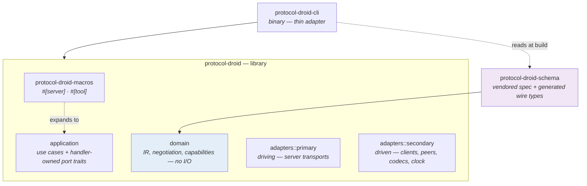

`protocol-droid-schema` is a **build-time** dependency of the library's types,
not a runtime one: its generated modules are compiled in, and the vendored
`schema.json` / `schema.ts` under `crates/protocol-droid-schema/spec/<version>/`
is the single source of truth. Wire shapes are never hand-written and never
remembered — they are read.

---

## Layer model

Collapsed hexagonal / DDD-lite. Four directories under `src/`, and
**no `ports` module**.

| Layer       | Location              | May contain                                                       | May not contain                                       |
| ----------- | --------------------- | ----------------------------------------------------------------- | ----------------------------------------------------- |
| Domain      | `domain/`             | value objects, aggregates, pure functions                         | I/O, traits, tokio, `serde_json::Value` in signatures |
| Application | `application/`        | one module per use case, handler-owned port traits                | third-party error types, concrete adapters            |
| Primary     | `adapters/primary/`   | driving adapters: server transports, CLI                          | business rules                                        |
| Secondary   | `adapters/secondary/` | driven adapters: client transports, peers, codecs, clock, RNG, FS | business rules                                        |

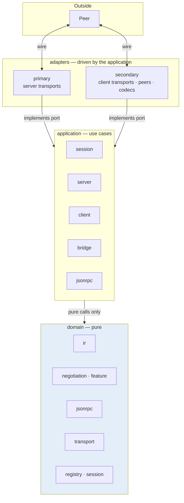

The dependency rule is one-directional: **adapters → application ← domain**.
Nothing in `domain/` knows an adapter exists, and nothing in `application/` names
a transport, a runtime, or an HTTP client.

### Why there is no `ports` module

A shared ports module is the usual next step in this layout, and it is wrong
here for a specific reason: **port traits belong to the consumer**. A
`SessionStore` trait written for everyone becomes a trait for everyone — a method
added for the record/replay use case shows up on the serving use case, and the
adapters implement methods they do not have.

So each handler declares its own, one to three methods, beside the code that
calls it:

```rust
// in application/server/session_store.rs — the trait exists because this
// handler needs it, not because the project decided to have one
pub trait SessionStore: Send + Sync {
    async fn get(&self, id: &SessionId) -> Option<StoredSession>;
    async fn put(&self, session: StoredSession);
}
```

Composed via supertraits only when a handler genuinely needs both. Adapters
export concrete structs that implement these traits and never re-export the
trait itself.

---

## The canonical IR

`domain/ir/` — the reason the crate exists.

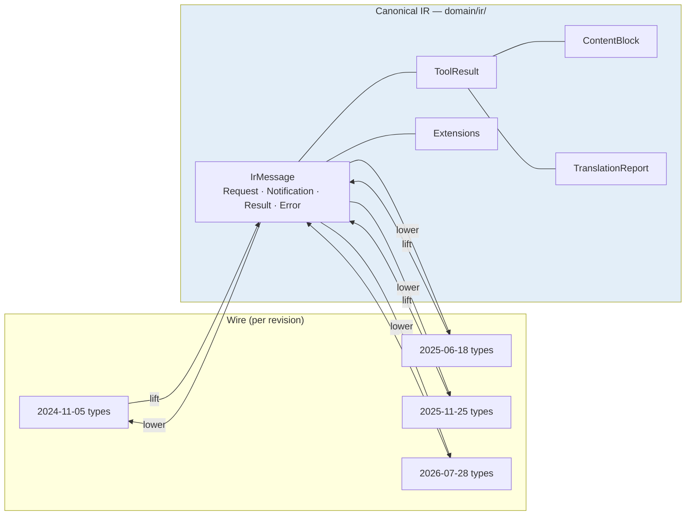

### `IrMessage`

```rust
pub enum IrMessage {
    Request(IrRequest),
    Notification(IrNotification),
    Result(IrResult),
    Error(IrError),
}
```

Lifting is `lift_envelope` / `lower_envelope`; these are the two boundaries where
raw JSON stops existing. After them, no `serde_json::Value` and no `String`
carries protocol meaning.

### `Extensions` — the losslessness rule

`domain/ir/extensions.rs` preserves fields the IR does not model, per message.
This is what makes the bridge lossless for anything it has never heard of: an
unmodelled member in `_meta` or a vendor directive survives the hop untouched
rather than being stripped by a schema the builder did not anticipate.

The consequence, which is easy to get backwards: **a directive the IR does not
model is forwarded byte-for-byte, never "helpfully" interpreted.** The bridge
cannot know whether the peer honoured a directive it does not understand, so it
has no loss to record. A `DegradeRule` here would report a loss the bridge never
observed — worse than reporting nothing.

### `TranslationReport`

`domain/ir/lower/` — every lowering records what it did. Each step is a
`TranslationStep` with a `Loss` describing whether the value was exact,
downgraded under a rule, or refused.

The property under test is `lift(v, lower(v, ir)) == ir` for every IR value
expressible at revision `v`. A value that cannot be expressed at the target
either errors or degrades under an explicit rule that is **recorded**. It is
never dropped quietly.

---

## Negotiation and the FeatureProfile

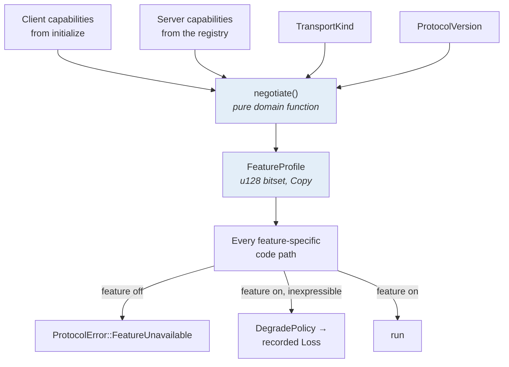

`negotiate()` is pure and has no I/O. This is deliberate: the gating decision is
the one thing most worth testing exhaustively, and a pure function can be
property-tested without a runtime or a socket. `FeatureProfile` is a `u128`
bitset and is `Copy` — it is passed by value to every check.

Every feature-specific code path consults it. There is no path that runs a
feature without asking. That is the rule, and it is checked by the feature
matrix golden test rather than by review.

---

## Request lifecycle

The hot path. Decode once, route once, decode params lazily.

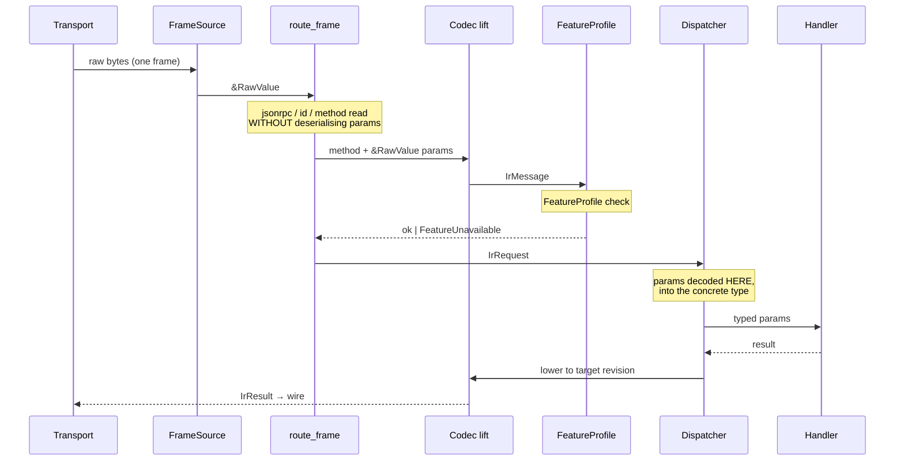

Two rules make the hot path fast, and both are easy to break:

- **No double-parse.** The envelope (`jsonrpc`, `id`, `method`) is decoded once
  with borrowed `&RawValue` params. Params become a concrete type only _after_
  routing has decided they are needed.
- **No intermediate `serde_json::Value` on the hot path.**

The consequence for reviewers: if you find a `serde_json::Value` in a domain
signature, or a second parse of the same frame, that is a defect rather than a
style question.

---

## Serving

The consumer's whole path is one call.

```rust
Greeter.into_server()?.serve_stdio().await?
```

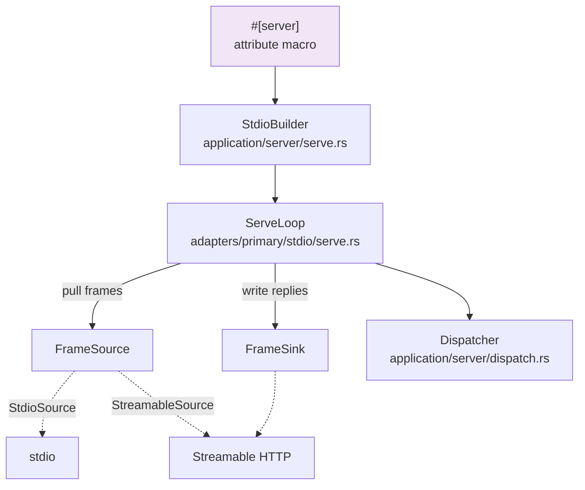

The builder resolves a **pre-handshake** profile from a _ceiling_, not from
`latest_known()`. `2026-07-28` has no `initialize`, so a session gated on it
could never complete a handshake with anybody. The revision the peer is actually
told is settled from its own `initialize`; the ceiling only decides what gates
the moment before, and what a peer that never sends one falls back to.

The layer types stay public underneath — `StdioBuilder` in `application`,
`ServeLoop` in the stdio adapter, `Dispatcher` in `application` — for anyone who
wants the control. The split is honest about which side is which: `ServeLoop`
lives in `adapters/primary/stdio/` because it names the runtime and the
transport, and putting it in `application/` would be the one place the layer
rule gets bent.

The point is that none of it is _required_. The rule this codebase holds itself
to: a `Server` that cannot be served without hand-assembling a dispatcher, a
session, a batch policy, a diagnostics sink and a transport config has moved the
work onto the consumer rather than removing it.

Callbacks and notifications are wired to `NoCallbacks` / `NullSink`, which
**refuse rather than pretend**. A stdio loop performs no server-initiated
requests; a sink that reported success would make two writers racing look like a
passing test.

---

## The bridge

`application/bridge/` — the version-translating proxy. Two peers, one agreement,
each on its own revision.

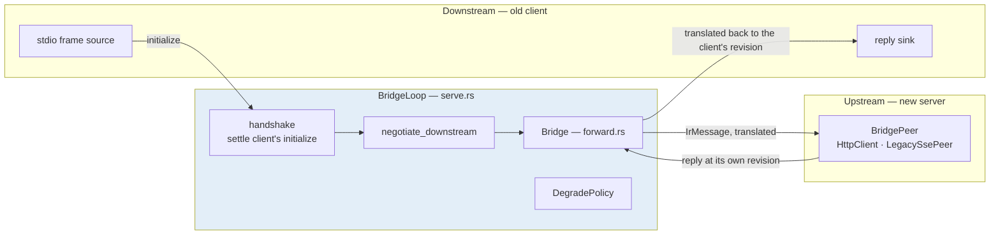

### What the bridge holds

```rust
Wiring::new(leg, policy, peer, WireToolResults)
```

A `Leg` — the upstream side as negotiated **by reference on the same connection
the bridge then forwards over**. That detail is load-bearing: a handshake over
one connection and forwarding over another would produce an `Agreement`
describing a server the bridge is not talking to. `Agreement` is only worth
having if it is the truth about two real peers.

### Where the client channel lives

Not in `Bridge`. `BridgeLoop` reads a `FrameSource` and writes a `FrameSink`;
that is the client's channel, and it belongs to whoever opened it.

`Bridge` used to take a downstream peer and describe itself as "carries envelopes
from `downstream` to `upstream`". It never did. `forward()` takes the envelope as
an argument and returns the answer, so the downstream peer was reachable only
from `client()` — which nothing called — and `close`. `close()` now closes the
upstream alone: the client's stream ends when the client stops sending, and the
loop is what notices.

The CLI makes this concrete. Wiring a real downstream peer would have meant the
CLI inventing a **second stdio handle** while the loop read the same stream
through the first.

### Pre-handshake requests are refused

A request arriving before the client's `initialize` is answered with a typed
error, not forwarded. There is no revision to lower it to yet, and guessing one
would be exactly the silent corruption the IR exists to prevent.

---

## Transports

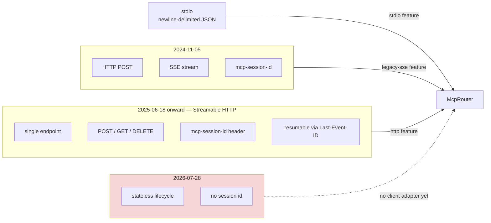

Each transport is a feature, and the feature set is genuinely optional:

| Feature      | Gates                                       | Dropped when off                                   |
| ------------ | ------------------------------------------- | -------------------------------------------------- |
| `stdio`      | `dep:tokio`, stdio source/sink/client       | the executor and `AsyncRead`/`AsyncWrite` plumbing |
| `http`       | `reqwest`, axum, the Streamable HTTP router | `McpRouter` and the whole HTTP surface             |
| `legacy-sse` | the legacy router and client                | the 2024-11-05 transport                           |

`default-features = false` leaves the domain, the IR and every codec — the shape
a tool that only speaks the IR wants. Schema revisions are **always** compiled;
they are data, not an integration.

The CLI adds one more, `bridge`, which pulls `http` + `stdio` + `legacy-sse`.
`--check-result` stays outside it on purpose: that probe opens no socket, so a
build that cannot open one should still be able to answer what the bridge _would_
do with a given reply.

---

## Error handling

The split is deliberate and per-crate, not a style choice:

| Crate                | Strategy             | Why                                               |
| -------------------- | -------------------- | ------------------------------------------------- |
| `protocol-droid`     | `thiserror`          | Consumers match on variants.                      |
| `protocol-droid-cli` | `anyhow` + `Context` | Nobody outside a binary crate matches its errors. |

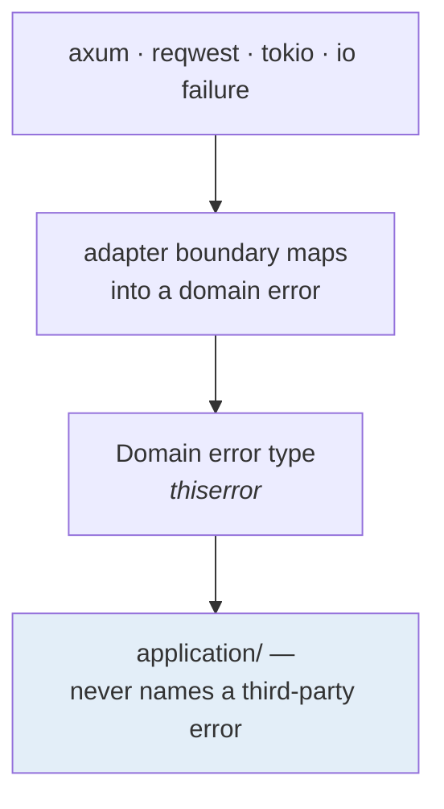

Adapters map infrastructure failures into domain errors at the boundary, so
`application/` never names a third-party error type. A handler returns
`BridgeError` or `LoopError`, never `reqwest::Error`.

Errors are **typed and specific**, carrying the field and the value that was
refused:

```rust
#[error("the method member is {found}, not a string")]
MethodNotAString { found: &'static str },
```

Three failure modes that must stay distinguishable, because collapsing them is
how a protocol implementation becomes impossible to debug:

| Failure                                  | Answer                                     |
| ---------------------------------------- | ------------------------------------------ |
| Peer refused                             | the error the server sent, verbatim        |
| Peer unreachable                         | transport-level, naming the endpoint       |
| Value not expressible at target revision | `LowerError` with the field and the target |

---

## Concurrency and determinism

The domain layer is **deterministic**. Time and session-id generation are
injected, never called globally:

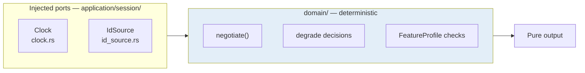

This is not stylistic. A protocol implementation's hardest bugs are ordering and
timing ones, and neither is reproducible if the code under test calls
`Instant::now()`.

### Port traits and `async fn`

A port trait written with `async fn` is native RPITIT and is **not object-safe**.
That is a real constraint, so the choice is made per trait:

| Situation                       | Shape                                                     | Why                            |
| ------------------------------- | --------------------------------------------------------- | ------------------------------ |
| Hot path, one implementation    | `impl Port` at the call site                              | zero-cost, no `dyn`            |
| Genuinely needs `Arc<dyn Port>` | `fn send(&self) -> Pin<Box<dyn Future<...> + Send + '_>>` | object safety                  |
| Already boxed elsewhere         | `async-trait` permitted                                   | the allocation is already paid |

`async-trait` is never used on the JSON-RPC hot path, where the per-call
allocation is exactly what the single-pass decode is removing.

---

## Safety and security

- **Fail-secure, default deny.** Authorization predicates are pure domain
  functions. Policy is enforced _before_ data access, never after.
- **`AuthContext` is a required parameter** on every stateful port method. Not
  optional, not defaulted.
- **Redaction at the tracing boundary.** Tokens, `Authorization` headers,
  session ids in full, and elicitation responses are never logged — and that
  redaction is itself tested.
- **No secrets in source.** Credentials come from the environment or a secrets
  manager.
- **Rate limiting and headers are wired, not merely defined.** `OriginPolicy`
  lives in `transport::origin` and is used by `McpRouter`, after T17 found it
  parked under `legacy_sse/` where Streamable HTTP answered a foreign `Origin`
  with 200. A security control that is defined in the wrong module is not a
  control.
- **`cargo deny` is re-run with network access** before removing any `ignore`
  entry. A local green pass reads a cached advisory database; CI always fetches
  fresh, and "green locally" is not evidence.

---

## Build, test and CI

```bash
cargo build --workspace --all-features
cargo test  --workspace --all-features
cargo l            # alias: clippy with the full profile, -D warnings
cargo deny --all-features check
```

`cargo l` runs with `-W clippy::pedantic -W clippy::nursery -W clippy::cargo
-W clippy::perf` and **denies** `unwrap_used`, `expect_used`, `panic`,
`indexing_slicing`, `cast_ptr_alignment`, `suspicious`. The denies apply across
`--all-targets`, so a `.unwrap()` in a test fails the build like any other.

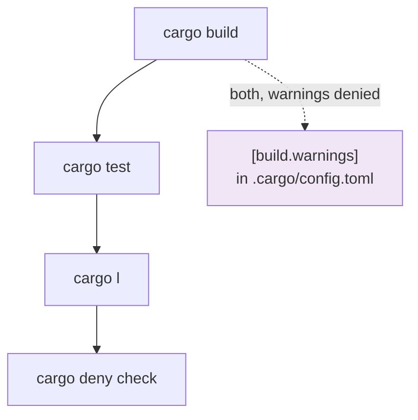

### Test layers

| Layer       | Files                                                                | Proves                                                                                           |
| ----------- | -------------------------------------------------------------------- | ------------------------------------------------------------------------------------------------ |
| Property    | `codec_round_trip.rs`, `lowering_properties.rs`, `jsonrpc_fuzz.rs`   | `lift(v, lower(v, ir)) == ir`; envelope decoding never panics                                    |
| Wire        | `http_transport_wire.rs`, `stdio_end_to_end.rs`                      | a real socket carries the header. A stubbed `HeaderMap` only proves both sides spelled it alike. |
| Golden      | `feature_matrix`, `negotiation_golden`                               | the matrix rows with their spec citations                                                        |
| Integration | `bridge_content.rs`, `in_process_exchange.rs`, `dynamic_registry.rs` | the bridge scenarios, registry mutation, session behaviour                                       |
| UI          | `ui/`                                                                | the macros' generated code compiles and runs                                                     |

### Benchmark gating

Performance-sensitive work updates a `divan` benchmark, and CI fails on a
greater-than-10% regression against the committed baseline.

---

## Known gaps

Recorded so they are not rediscovered as bugs.

| Gap                                         | Where                                                 | Consequence                                                                                                                                                                                                                                                    |
| ------------------------------------------- | ----------------------------------------------------- | -------------------------------------------------------------------------------------------------------------------------------------------------------------------------------------------------------------------------------------------------------------- |
| **Listen side is stdio-only**               | `listen_supported` in the CLI                         | `BridgeLoop` pulls frames from a `FrameSource`, and `StdioSource` is the only implementation. The axum router is request/response shaped, so an HTTP listen side needs a _subscription-shaped source_, not a router change.                                    |
| **Out-of-band upstream frames are dropped** | `take_pending` is called nowhere outside the adapters | `notifications/tools/list_changed` and friends never reach the client. A bridge that loses server-initiated messages is wrong in a way that only shows up when a client goes stale. This is the one gap that would justify a second handle on the client side. |
| **No stateless-HTTP client adapter**        | `serve::connect`                                      | `--upstream` cannot be `http-stateless`. The _server_ side exists; the client half does not.                                                                                                                                                                   |
| **No `stdio` upstream**                     | `serve::connect`                                      | `--upstream` carries `kind:target`, which has no room for a program and its arguments. This is an argument-grammar change, not a missing adapter — `StdioPeer` exists.                                                                                         |
| **A2A and ACP not started**                 | post-MVP                                              | The JSON-RPC core, session engine and transports are protocol-neutral so both slot in without a refactor.                                                                                                                                                      |

The first two keep the `protocol-droid bridge` task (`[~]`) open: "across any
transports" is not yet true on the listen axis.
